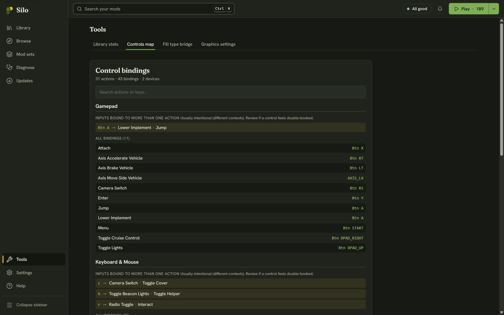

The **Controls map** shows your whole control layout in one place: every action, paired with the key, mouse button or gamepad button that triggers it. Silo reads it from the game's own `inputBinding.xml` and lays it out so you can scan it or search it.

## When to use it

Open it when a control feels double-booked: you press a key and two things happen, or a mod's action seems to collide with one from the base game. It's the quickest way to answer "what does this key do, everywhere?" without going through the game's settings one action at a time.

## Opening it

Open **Tools** in the left rail and choose the **Controls map** tab. Silo reads `inputBinding.xml` from your Farming Simulator 25 user folder.

If you have never launched the game, there's no bindings file yet and Silo tells you so. Start the game once, set up your controls, and come back.

## What you'll see

Under **Control bindings**, a line gives the totals: how many actions, bindings and devices Silo found. The bindings are grouped by device, usually **Keyboard & Mouse** and **Gamepad**. Each device has up to two parts:

- **Inputs bound to more than one action**: every key or button on that device that drives two or more actions, with all the actions it maps to. This is where a real clash would show up.
- **All bindings**: the full list of actions and their inputs for that device, with a count.

Names are tidied up for reading. Prefixes such as `KEY_` are dropped, action names are spaced out, and key combinations are joined with `+`.

## Finding a control

Type in **Search actions or keys…** at the top. It filters both parts as you type. Search by action (for example `lights`) or by key (for example `h`) to jump straight to what you need.

## A view, not a verdict

The section for shared inputs isn't called a conflict list on purpose. On a normal profile, one input often drives several actions that never happen at the same time. One button can do one thing on foot and another in a vehicle, and Silo marks these as usually intentional. It shows you the reuse and leaves the judgment to you.

The Controls map only reads `inputBinding.xml`. It never edits, rebinds or writes anything, so there is nothing to undo. Silo has no binding editor: to change a control, use the controls settings inside Farming Simulator 25.
