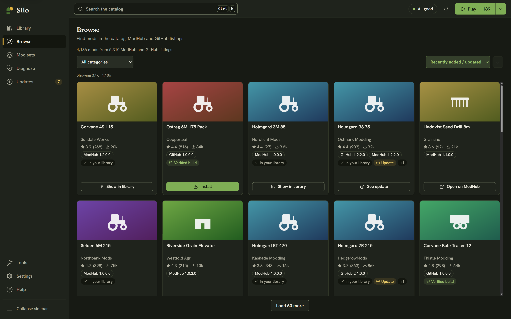

**Browse** (Alt+2 in the left rail) is Silo's catalog. Each mod gets one card, with its ModHub and GitHub listings merged, so the same mod doesn't show up twice. The line at the top says how many mods the catalog holds right now.

## Finding a mod

- **Search**: on Browse, the search box in the header reads "Search the catalog". Press Ctrl+K or / to jump to it.
- **Category**: pick a category, then a subcategory where there is one.
- **Sort**: Recently added / updated, Popular, Most downloaded, Top rated, or Name (A–Z).
- **Other filters**: when the catalog has them, menus such as Region, Era, Theme, Brand and Realism, and an **Available by year** filter. **Clear all** resets them.

The grid shows a page at a time, and the button at the bottom loads more. If nothing matches, Silo offers **Clear search** or **Clear filters**.

## Reading a card

Each card shows the cover, title, author, rating and downloads, and one chip per source with that source's own version, such as "GitHub 1.0.6.0" and "ModHub 1.0.6.0". Versions on different sources can drift apart, so each is shown. A mod you already have carries an **In your library** badge. **Verified build** means Silo's catalog hashed the published build, so Silo can check your copy against it (see [Checking a mod's integrity](/help/provenance/)).

The button on a card says what it will do:

- **Install**: Silo can download it for you. These are GitHub releases.
- **Open on ModHub**: ModHub mods download from GIANTS' website, so Silo opens the mod's page there in your browser.
- **Show in library**: you already have it.
- **See update**: you have it and a newer version is out. This opens **Updates**.

Click anywhere else on a card to open its details.

## Installing from GitHub

Click **Install**. The button shows the download's progress, then Silo places the `.zip` in your mods folder and reads your library again. A toast says "Installed" with the mod's name and offers **Show in library**. When Silo's catalog has the published build on file, Silo checks the download against it and refuses a file that doesn't match. You don't need a GitHub account to install.

One install runs at a time. Installs don't queue behind other work: while another change to your library is running, such as a mod set switch, Silo refuses the install and says why, for example "Silo is moving mods. Try again when it's done." Installing only adds a new file: it never replaces a file that's already there. The new mod is active, because it's in your mods folder. If **Auto-file new mods** is on in **Settings**, then **Library**, Silo files it into your library and keeps it active. To undo an install, park the mod, or delete its `.zip`.

## Getting a mod from ModHub

Click **Open on ModHub**, download the `.zip` from the mod's page and save it into your mods folder. When you come back to Silo, it reads the folder again and finds the new mod. If auto-filing is off, the **Library** status strip says how many new mods aren't filed, with **Review**. To update a mod you already have, see [Keeping mods updated](/help/updates/).

## The details drawer

The drawer shows the cover, author and version, the Mod ID, category, rating, downloads and description, with **Read more →** for the full text. **Available from** lists each source with its version and its own **Install**, **Open on ModHub** or **Show in library** button. For a GitHub source it also shows the repository's stars, watchers and open issues; with GitHub connected and the permission switched on, you can star and watch it from here. Close the drawer with its close button or Esc.

## Browsing without the app

The same catalog is on the web at [silo.hllmr.com/browse](/browse/). Installing still happens in Silo.
