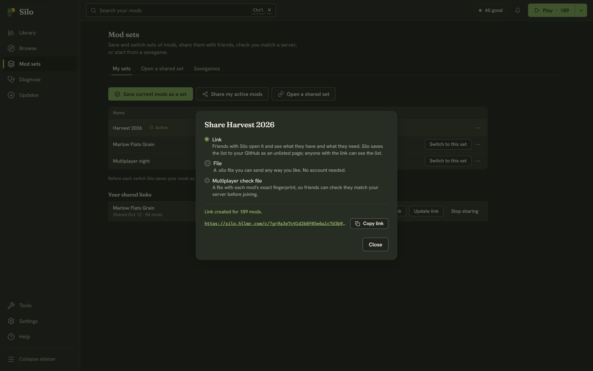

Share a [mod set](/help/loadouts/) when you want someone else to reproduce it: your co-op pack, or the mods a server runs. Sharing sends the list of mods and where to get them, never the mod files.

## Sharing a set

In **Mod sets**, then **My sets**, choose **Share…** from a set's **⋯** menu, or click **Share my active mods** to share what you have on now. The **Share** dialog offers three ways:

- **Link**: friends with Silo open it and see what they have and what they need. Silo saves the list to your GitHub account as an unlisted page. It isn't listed or searchable, but anyone who has the link can see the list, so send it only to the people you mean to. Click **Create link**, then **Copy link**.
- **File**: a `.silo` file you can send any way you like. No account needed. Click **Save file…**.
- **Multiplayer check file**: lets friends check they match your server before joining. See [Playing multiplayer](/help/multiplayer/).

A link needs GitHub connected with sharing allowed. If it isn't, the dialog offers **Connect GitHub**, which takes you to **Settings**, then **Accounts**, where **Enable sharing links** grants that permission (see [Settings and accounts](/help/settings-accounts/)). Files need nothing.

Only mods packed as `.zip` files can go on a link; the dialog says how many in unpacked folders are left out. Mods the set names that aren't in your library are left out too.

## Your shared links

Once GitHub can hold links, **My sets** lists **Your shared links** with the date each was shared:

- **Copy link** copies it again.
- **Update link** points it at your current active mods. The link stays the same, so friends who have it see the new list.
- **Stop sharing** removes it from your GitHub, and the link stops working. This can't be undone, but you can share the set again with a new link.

Older versions of Silo shared links as public `silo-…` repositories on your GitHub. Those still appear here with **Copy link** and **Update link**, but with **Stop sharing on GitHub** instead: Silo won't delete a repository, so this opens it on GitHub, where you can delete it yourself. New links are always unlisted pages.

## The shared set page

A link looks like `https://silo.hllmr.com/c/?g=…`. Opened in a browser, it shows the set's name, who shared it and its mod list, with **Open in Silo** and **Get Silo first**. The page reads the list from GitHub in your browser, and no mod files pass through it.

## Opening a shared set

In **Mod sets**, choose **Open a shared set**. Paste a link and click **Open**, or click **Choose a file…** for a `.silo` file. **Open in Silo** on the shared set page lands here too.

Opening only shows what's in the set. Nothing is downloaded, saved or switched until you choose to. The preview sorts the mods into:

- **Silo can download**: GitHub releases Silo can install for you.
- **Get from ModHub**: ModHub mods you download yourself, with **Find in Browse**.
- **Different version than yours**: your version next to the set's.
- **Couldn't find**: mods Silo's catalog doesn't know, with **Find in Browse**.
- **Already in your library**.

A **Heads-up** block lists conflicts among the set's mods you already have, and required mods that neither the set nor your library provides.

Then choose:

- **Download N and save as a set** downloads what Silo can into your mods folder, the same guarded way a [Browse install](/help/browsing-installing/) does, then saves the whole list as a mod set.
- **Save as a set without downloading** saves the list only. When there's nothing to download, the button is just **Save as a set**.

Your active mods don't change either way. Click **Switch to it** when you're ready, which shows the usual switch preview and offers **Undo** afterwards. Opening a set never removes or replaces a mod you already have. If the set changed after you previewed it, Silo stops and offers **Preview again**.
