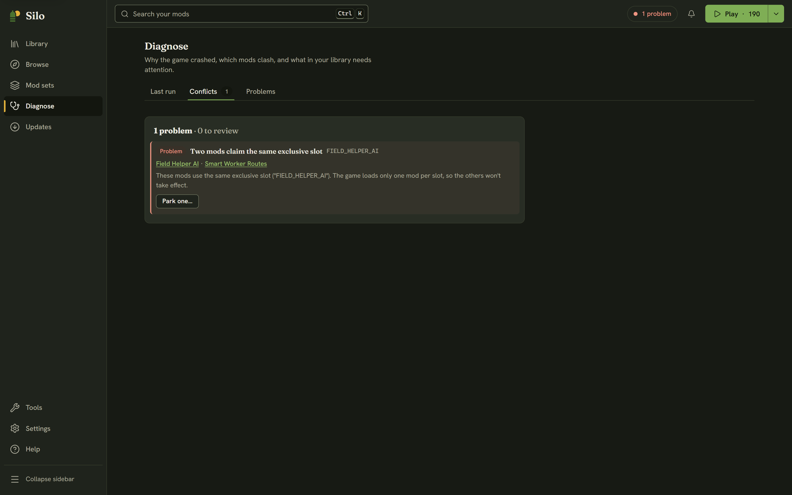

Some mods can't work side by side. Two of them may claim the same slot, or one may quietly replace another's settings, and you often don't find out until the game misbehaves. Silo reads the `modDesc.xml` of every **active** mod and flags these clashes before you play. It checks again by itself whenever you change which mods are active, so there is nothing to rescan.

## Opening it

Click **Diagnose** in the left rail (or press Alt+4) and choose the **Conflicts** tab. The number on the tab, and the header status chip, count only the clashes that are a Problem or worth a Review. You can also start from a mod: its details show a **Conflicts with N active mods** banner with **See conflicts**, its row in the Library carries a **Conflict** badge, and the **In conflict** option under **Filters** narrows the Library to the mods involved.

## Problem, Review and Note

The headline reads like *1 problem · 0 to review*. Each clash has one of three labels:

- **Problem**: the game will load only one of these mods' versions of something, so at least one of them won't work as intended. Fix these.
- **Review**: something that can go wrong depending on load order. Worth a look.
- **Note**: for your information only. Notes are hidden until you turn on **Show notes**.

## What Silo checks

Each row has a plain title:

- **Two mods claim the same exclusive slot**: the game loads only one mod per slot (shown as **Exclusive slot** in a mod's details). A Problem.
- **Two mods add the same feature name**, and the same check for a vehicle type, building type, hand tool type, control action, brand or shop category: only one of them takes effect. A Problem.
- **Two mods ship a script with the same file name**: depending on which loads last, one may replace the other. A Review. If the file is identical in each mod, it's shared code, so it becomes a Note.
- **Two mods define the same fill type**: whichever loads last replaces the others' settings, such as capacity and price. A Review.
- **More than one map is active**: a Note, not a conflict. Only the map your savegame uses loads, and the others wait until you start a save on them.

When every mod in a clash has the same author, it's most likely deliberate, so Silo lowers it one step (a Problem becomes a Review, a Review becomes a Note) and says so in the explanation.

## Fixing a clash

1. Read the explanation and decide which mod to keep. Click a mod's name to open its details in the Library.
2. Click **Park one…** and choose the mod to park.
3. Silo parks it and shows a toast with **Undo**. The conflict list updates on its own.

Parking never deletes a mod. It stays in your library, and you can switch it back on any time. While another change to your library is running, **Park one…** is off and says why. For two mods by different authors that you want to keep together, the clash is worth reporting to their authors.
