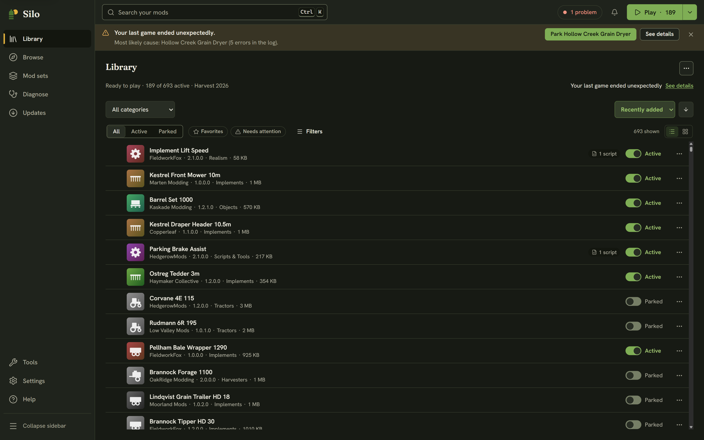
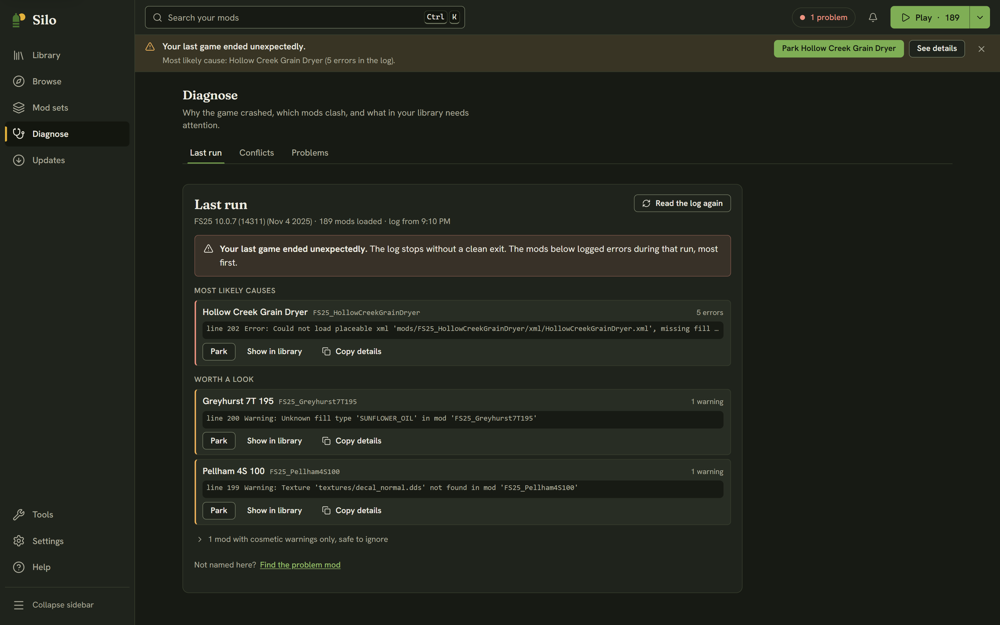

When Farming Simulator 25 crashes or misbehaves, the explanation is in its `log.txt`, buried in thousands of lines that are mostly harmless. Silo reads that log for you, tells you whether your last game crashed, and ranks the mods by the errors they logged during that run. It only blames a mod when the log names it, and it never guesses.

Reading the log changes nothing: not `log.txt`, not your mods, not the game. Only the buttons you press act, and parking has an **Undo**.

## The crash notice

You don't have to go looking. Silo checks the log when you come back to its window, and while a game it launched is running it keeps an eye out until the game closes. If the last game ended without a clean exit, a notice appears at the top of the window: *Your last game ended unexpectedly.*

- When the log names an active mod, the notice gives the most likely cause and its error count, with a button to park it (for example **Park Hollow Creek Grain Dryer**). Parking shows a toast with **Undo**, and the notice then suggests playing again to check.
- When the log names no mod, the notice reads *Your last game ended unexpectedly, and the log doesn't name a mod.* If you have at least two active mods that aren't maps, it offers **Find the problem mod** (see [Find the problem mod](/help/guided-bisection/)).
- **See details** opens **Diagnose**, **Last run**. The **×** dismisses the notice.

Until your next clean run, or until you dismiss it, the crash counts as one problem in the header status chip.

## Diagnose, Last run

Click **Diagnose** in the left rail (Alt+4). **Last run** is the first tab. Under the title, a line shows the game version, how many mods loaded and when the log was written. **Read the log again** refreshes it.

The verdict comes in one of three forms:

- **Your last game ended unexpectedly.** The log stops without a clean exit.
- **Your last game closed normally,** but some mods logged errors worth a look.
- **Healthy.** Your last game closed normally and no mod logged a real error.

Below it, the mods the log named:

- **Most likely causes** (headed **Mods with errors** after a clean exit): mods that logged real errors, most first. Each row shows the counts and the first error line, which you can expand.
- **Worth a look**: mods with real warnings but no errors.
- **Mods with cosmetic warnings only, safe to ignore**, folded away. Notices like a missing translation never crash the game.

Each row in the first two groups has **Copy details**, which copies the name, counts and log line for a bug report. A mod in your library also gets **Show in library**, which opens its details, and an active one gets **Park**. A mod the log names that isn't in your library shows *Not in your library*. Rows with cosmetic warnings only have no buttons. A mod's details also show a **Logged N errors in your last game** banner with **See in Diagnose**.

## When the log names no mod

Findings the log can't tie to any mod are counted at the bottom as engine or base game, with **Open log.txt** so you can read the lines yourself. If the game crashed and no mod logged an error, the log can't tell what caused it. Often it's mods that only break together. **Find the problem mod** tests half your mods at a time to find it, and a **Not named here?** link offers the same for any other run.

If you have never played with this setup, there may be no log yet: launch the game once, then come back.
