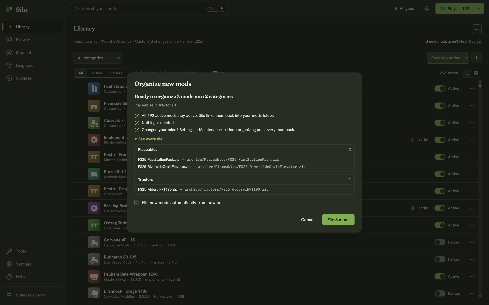
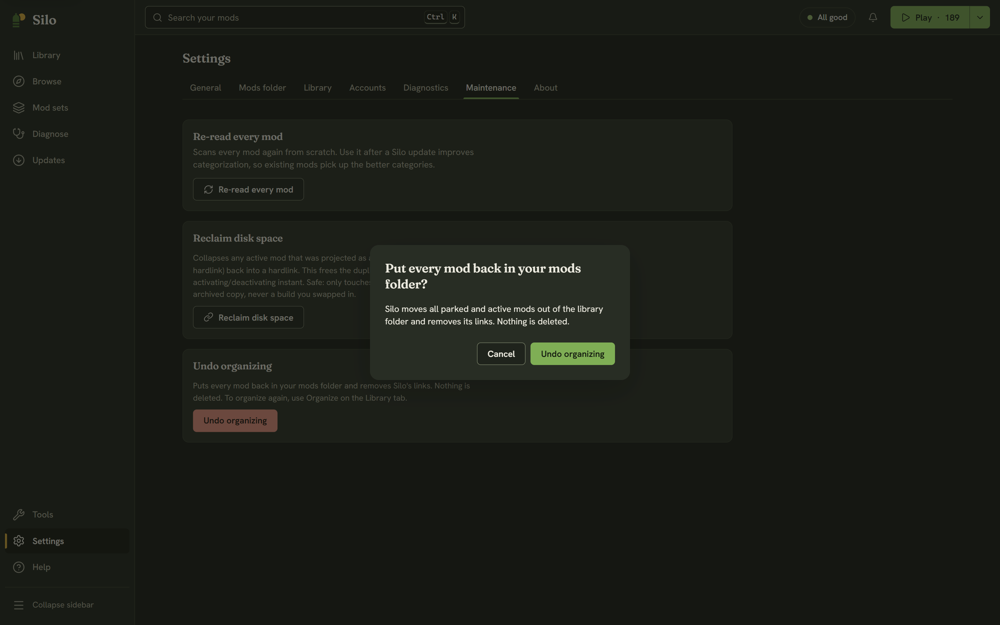

## Organize

Organizing files your loose mod zips into category folders in your [library archive](/help/library-archive/), for example `archive\Scripts & Tools`. The game only reads the top of the mods folder, so it ignores those subfolders. Your active mods stay active: Silo links them back into the mods folder, or copies them when the folder is cloud-synced. Unzipped folder mods are left where they are, and nothing is deleted.

When new zips are waiting, the status strip above the Library list says "N new mods aren't filed" with **Review**. You can also start from **Settings**, then **Library**, with the **Organize** button on the **Library layout** card.

Either way opens the **Organize new mods** dialog. Nothing has moved yet:

- A summary says how many mods go into how many categories, and that active mods stay active and nothing is deleted.
- **See every file** lists each mod and the category folder it goes to.
- **File new mods automatically from now on** turns on auto-filing.

Click **File N mods** to go ahead, or **Cancel**. Progress shows at the bottom of the dialog. If some mods can't be moved, the dialog stays open and lists them with the reason and **Copy details**; the rest are filed, and the ones that failed stay in your mods folder.

**Auto-file new mods** (in **Settings**, then **Library**) files new zips as they appear in your mods folder and keeps them active, without the dialog. It's off until you turn it on.

## Undo organizing

**Undo organizing** is the only undo for organizing, and it undoes all of it: there is no undo for a single batch. Open **Settings**, then **Maintenance**, and click **Undo organizing**. Silo asks **Put every mod back in your mods folder?**, then moves every parked and active mod out of the library folder and removes its links. Nothing is deleted. Afterwards the game loads every mod in that folder again, including the ones you had parked. To organize again, use **Organize**.

## Favorite, hide and flag

These live in a mod's **⋯** menu in the Library (or right-click), in the **⋯** menu of its details, and, for several mods at once, in the selection bar.

- **Favorite** marks the mods you reach for most. The **Favorites** chip shows only those.
- **Hide** leaves a mod out of the list. Turn on **Hidden** in **Filters** to see hidden mods again. Hiding never parks or deletes a mod.
- **Flag** is your own note that a mod is broken or not to be trusted. A flagged mod shows a **Flagged** badge, counts toward **Needs attention**, and has its own **Flagged** filter. It is separate from Silo's own checks.

Each one is a toggle: the same menu says **Remove favorite**, **Unhide** or **Remove flag** to clear it.

## Rating, tags and notes

Open a mod's details and scroll to **My notes**:

- **Rating:** click a star (1 to 5). Click the same star again to clear it. Sort the Library by **My rating** to use it.
- **Tags:** type in the **add tag…** box and press Enter. Click a tag to show every mod with it, or its ✕ to remove it. The **Tag** picker in **Filters** does the same.
- **Notes:** anything you want to remember. It saves when you click away.

## Category

If Silo filed a mod under the wrong category, open its details and use the **Category** section: pick a category and an optional subcategory, then **Save category**. The section then says **Set by you**, and **Reset to automatic** goes back to Silo's choice. In the Library, **Change category…** in a mod's menu opens a quick list of categories, with **Reset to auto** at the bottom.

> None of this touches your mod files or the game. Favorites, flags, ratings, tags and notes are kept in Silo's own database, tied to each mod's Mod ID, so they survive updates and moves. Clear everything on a mod and Silo drops its record.
