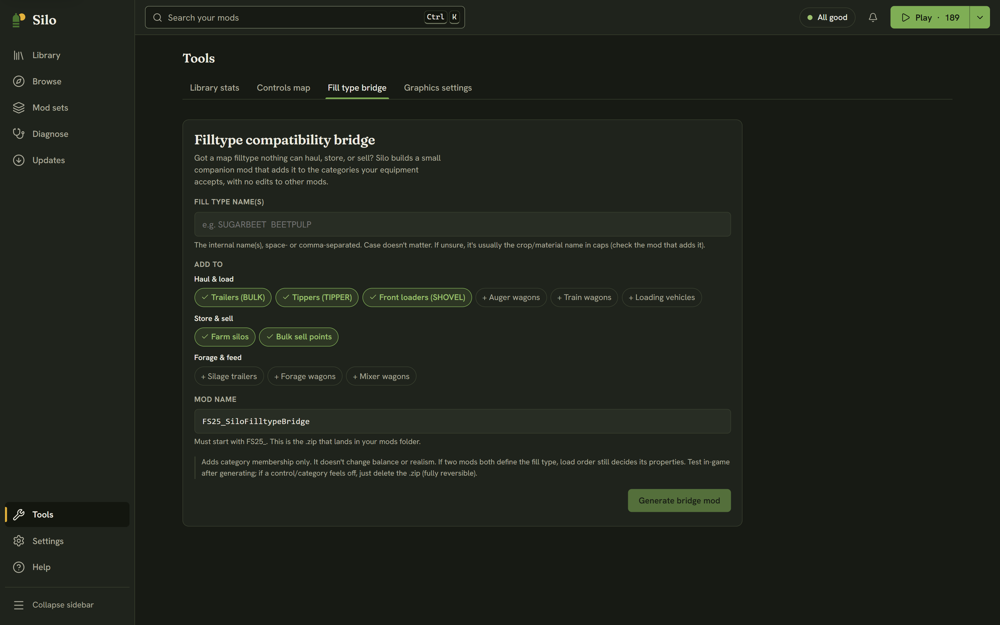

Some maps add their own fill types, such as a custom crop or material, that none of your equipment will handle. Farming Simulator 25 decides what a trailer, shovel, silo or sell point can take by category: a trailer takes `BULK`, a front loader takes `SHOVEL`, and so on. When a map's fill type isn't in any category your equipment accepts, nothing can harvest, haul, store or sell it, and there's no setting in the game to change that.

The **Fill type bridge** fixes this without editing any vehicle or other mod. Silo builds a small companion mod whose only job is to add the fill type to the categories you choose. It refers to the fill type by name and adds nothing else: no textures, no new definition, no balance changes.

## When to use it

Use it when a map's fill type won't work with equipment that should obviously handle it: your trailer won't fill, a silo won't store it, or a sell point doesn't list it. The classic case is a sugar beet style crop that a map adds and the base game trailers ignore.

## Making a bridge mod

1. Open **Tools** in the left rail and choose the **Fill type bridge** tab.
2. In **Fill type name(s)**, type the internal name or names, separated by spaces or commas, for example `SUGARBEET BEETPULP`. Case doesn't matter. If you're not sure, it's usually the crop or material name in capitals; the mod that adds it will have it. The names Silo picked up appear as chips below the field.
3. Under **Add to**, choose the categories. They're grouped as *Haul & load*, *Store & sell* and *Forage & feed*. Trailers, tippers, front loaders, farm silos and bulk sell points are chosen to start with.
4. Keep the **Mod name** or change it. It must start with `FS25_`, and it becomes the name of the `.zip` file.
5. Click **Generate bridge mod**.

Silo writes the `.zip` into your mods folder and reads your library again, so the new mod shows up in the Library straight away. Make sure it's active, load your save, and the fill type should now work with the equipment in the categories you chose.

## Undoing it

The bridge only adds category membership. It doesn't change prices, capacities or realism. If two mods both define the fill type, load order still decides its properties. To undo it, park the bridge mod, or delete its `.zip` from your mods folder.

Silo never overwrites a file. If a mod with the same name is already in your mods folder, it stops and tells you, so pick another name or remove the old bridge first. While another change to your library is running, such as a mod set switch, Silo asks you to try again when it's done.

A bridge mod only adds data, so it's fine in multiplayer as long as everyone in the session has the same bridge mod.
