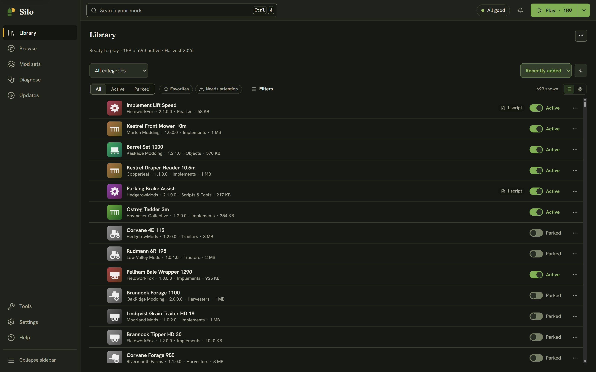

Silo is a desktop app for your Farming Simulator 25 mods. It isn't an in-game mod: it runs on your computer next to the game and works with the files FS25 already keeps in `Documents\My Games\FarmingSimulator2025\`. Silo never edits the game itself.

## Install

Get Silo from the [download page](/download/) or the [Releases page](https://github.com/HLLMR-VENTURES/silo/releases).

- **Windows:** the setup `.exe` (recommended) installs Silo for your user account and needs no administrator rights. The `.msi` installs it for everyone on the PC and asks for administrator rights. The installers are signed by Silo's developer, **David Hellmer**. A brand-new release can still show a blue "Windows protected your PC" prompt while it builds reputation: click **More info**, then **Run anyway**.
- **macOS (preview):** open the `.dmg` and drag Silo to Applications. The Mac build isn't signed by Apple, so macOS blocks the first launch. Open Silo once, then go to **System Settings**, then **Privacy & Security**, and click **Open Anyway**.
- **Linux (preview):** an `.AppImage` (make it executable with `chmod +x`), a `.deb` or an `.rpm`.

Windows is the tested platform. Silo runs natively on macOS and Linux, but it hasn't been tried on many real machines there yet.

## First run

A new library opens a short setup with three steps. **Skip setup** (top right) takes you straight to the Library with nothing moved.

1. **Your mods.** Silo finds the folder FS25 reads, including a custom folder set in the game, and starts reading your mods in the background. Press **This is right**, or **Choose another folder…**. If the game hasn't made its mods folder yet, **Create it** makes it for you.
2. **How Silo keeps them.** Active mods load in the game; parked mods are kept by Silo and not loaded. Choose where parked mods live: inside your mods folder (recommended), or **On another drive…**. You can also tick the box to file new mods automatically.
3. **Organize.** Silo shows what organizing would do before anything moves: how many mods go into which categories, that your active mods stay active, and that nothing is deleted. Press **Organize N mods**, or **Not now, show my library**. If you change your mind later, **Settings**, then **Maintenance**, then **Undo organizing** puts every mod back.

If you used an earlier Silo, you get a one-time **What's new in Silo 1.0** card instead of the setup. **Help**, then **See what's new** shows it again.

## Finding your way around

The sidebar on the left holds the five main places: **Library** (your mods), **Browse** (find new ones), **Mod sets** (saved sets, sharing and savegames), **Diagnose** (crashes, conflicts and problems) and **Updates**. **Tools**, **Settings** and **Help** sit at the bottom.

The header across the top has:

- **Search**: your mods, or Silo's catalog while you're in Browse.
- The **status chip**: "All good", "N problems" or "N to review". Click it to open Diagnose.
- The **Activity** bell: what Silo is doing right now, and recent errors with **Copy details**.
- **Play**: starts the game with your active mods. Its menu shows which mod set you're on.

## Keyboard shortcuts

| Keys | What it does |
|---|---|
| Ctrl+K or / | Search |
| F5 or Ctrl+R | Rescan your library |
| Alt+1 to Alt+5 | Library, Browse, Mod sets, Diagnose, Updates |
| Ctrl+, | Settings |
| Alt+← | Back to the previous page |
| F6 or Shift+F6 | Move between the sidebar, header, notices, page and details |
| Esc | Close the mod details, a menu or a dialog |
| ↑ ↓ Home End | Library: move between mods |
| Enter | Library: open the mod's details |
| Space | Library: turn the mod on or off |
| Shift+F10 | Library: the mod's actions menu |
| ? | Show every shortcut |

Search, Rescan, Settings and F6 work while you're typing in a field. The others wait until you leave it.

Next: [Your library: active and parked mods](/help/library/).
