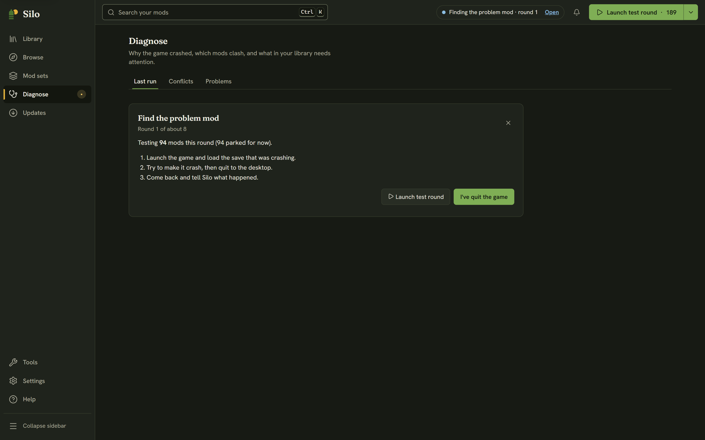

Sometimes the game crashes or misbehaves and the log never names a mod. The cause is often two mods that only break together, which no single log line can point to. **Find the problem mod** does the community's old routine for you: park half your mods, play, see whether the problem is still there, and repeat. Silo keeps track of the halves; you play and tell it what happened.

Because each round halves the suspects, it's quick. Around 190 active mods take about eight launches, not 190.

## Starting it

You can start from three places:

- the crash notice's **Find the problem mod**, when the log named no mod (see [When the game crashes](/help/crash-triage/));
- the **Find the problem mod** button in **Diagnose**, **Last run** after such a crash;
- the **Not named here?** link under any Last run report, for a problem the log doesn't explain.

You need at least two active mods that aren't maps. The first screen says how many mods will be tested and about how many launches it will take. If some of your mods are unzipped folders, it says so too: Silo can only park mod zips, so those folder mods stay on every round. Press **Start**, or **Not now** to leave without changing anything.

If some of your active mods are loose zips that aren't in your library yet, **Start** first asks *File N mods into your library first?* Press **File them and start** to file them and begin. If you decline, nothing starts and nothing changes.

Before the first round, Silo saves the exact list of your active mods.

## Each round

1. Silo parks part of your mods for this round and shows **Round 2 of about 8**, with how many mods are being tested and how many are parked for now. Your maps stay on every round, so your save still loads. If a round can't be set up, Silo says why and offers **Try again**.
2. Press **Launch test round**, load the save that was crashing, try to make the problem happen, then quit to the desktop.
3. Back in Silo, press **I've quit the game**. Silo reads the log and, where it can tell, says whether the game crashed again or closed normally. If the game is still running, Silo says so: quit to the desktop, then press **I've quit the game** again.
4. Answer **It still happened** or **It's fine now**. Silo narrows the suspects and sets up the next round.

While a search runs you can move around Silo freely. The header shows *Finding the problem mod · round 2* with **Open** to come back, **Play** turns into **Launch test round**, and **Diagnose** in the left rail carries a dot.

## The result

- **Most likely:** names one mod that the crash followed in every round. **Put my mods back and park** it restores your saved list without that mod, so you can play straight away. **Put my mods back** restores everything as it was. If the mod only breaks together with another one, the pair is worth reporting to its author.
- **No single mod is at fault.** The problem only shows up when certain mods are on together, or it isn't caused by a mod. Silo says so plainly rather than blaming an innocent mod. **Put my mods back** restores your list.

## Getting your mods back

Your own list of active mods is never lost. You can stop at any time with the **×** (*Stop and put my mods back*). If Silo closes during a search, the next time it opens a notice says *A guided diagnosis was interrupted* and offers **Restore my mod set**. **Discard** keeps your mods as they are now and forgets the saved list, after asking first, because that can't be undone. A new search can't start until the earlier one is restored or discarded. If putting your mods back fails, Silo says why and offers **Close and restore later**, and your saved list is kept until you restore it.

Only maps and unzipped folder mods are kept on every round. Required mods aren't: a mod that needs another mod can land in a round without it and fail for that reason alone, so if a round's result looks odd, check the mods' requirements in their details.
