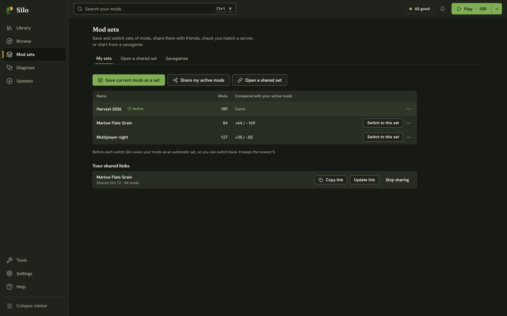

A **mod set** is a saved list of active mods. If you run several farms, say a heavy seasonal save, a light co-op save and a near-vanilla test, each wants different mods switched on. Save each mix once as a set, then switch between them when you change games instead of turning dozens of mods on and off by hand.

A set holds the list only, never the mod files. Switching to a set turns mods on and parks the rest, and parking a mod never deletes it. Deleting a set leaves your mods exactly as they are.

Open **Mod sets** in the left rail (Alt+3). The **My sets** tab lists every set with how many mods it holds and how it compares with your active mods right now: **Same**, or a count such as `+31 / −77` (31 would turn on, 77 would be parked). A set that names mods you don't have also says how many aren't in your library. The set that matches your active mods carries an **Active** badge.

## Saving your current mods as a set

Turn on the mods you want in the **Library**, then click **Save current mods as a set** and type a name. If you already have a set with that name, Silo asks whether to replace it. The button is off while no mods are active.

## Switching to a set

Click **Switch to this set**. Before anything changes, Silo shows what will happen: how many mods turn on, how many are parked, and the list of changes. Mods the set names that aren't in your library stay off until you get them. Click **Switch** to go ahead.

Before it switches, Silo saves the mods you had on as an automatic set named after the switch, such as "Before Forestry weekend". Automatic sets are marked **Automatic** with the date and have a **Switch back** button. Silo keeps the newest five. After the switch, a toast offers **Undo**, which puts your previous mods back.

## Changing or removing a set

The **⋯** menu on each row has:

- **Update from current mods**: replaces the set's list with the mods you have on now. Silo first says how many are added and removed, and your active mods don't change. A toast offers **Undo**.
- **Share…**: sends the set as a link or a file. See [Sharing and opening mod sets](/help/collections/).
- **Delete**: removes the set after you confirm. Your mods aren't affected, and a toast offers **Undo**.

Automatic sets can be shared or deleted but not updated, because Silo prunes them later. Save your current mods as a new set instead.

## Adding mods to several sets at once

You can add mods to your sets, or take them out, from the **Library**. Select one or more mods and click **Mod sets…** in the selection bar, or choose **Mod sets…** from a single mod's row menu.

The dialog lists your saved sets, each with a checkbox. Automatic "Before …" sets aren't listed.
- **Ticked:** every mod you chose is in that set.
- **Unticked:** none of them is.
- **Mixed:** some are.

Click a box to change it, then **Save**. **Tick all** adds the mods you chose to every set in the list in one click, and **Untick all** takes them out of every set. If you have no saved sets yet, the dialog says to save one on the **Mod sets** page first.

Editing the set you're on also turns those mods on or parks them, so you stay on that set. The dialog says so beside that set: "also turns them on now" or "also parks them now".

After **Save**, a toast offers **Undo**, which puts every set back and reverses any turn-on or park. If mods you took out of sets are still on, it also offers **Park them too** (**Park it too** for one mod).

## When your mods drift from a set

Silo remembers the set you last switched to. If you turn a mod on or off afterwards, Silo shows how far you've moved from that set instead of forgetting it:

- The **Library** status strip shows, for example, "Custom (3 changes since Harvest 2026)".
- The **Play** menu (the arrow beside **Play**) starts with "Custom: 3 changes since Harvest 2026", and offers **Update Harvest 2026 from current mods** and **Save current mods as a new set**. While nothing has changed it reads "Harvest 2026, unchanged".
- **My sets** shows the same note with **Update the set** and **Save as new**.

**Manage mod sets** in the **Play** menu opens this page.

Saving, replacing and deleting sets wait while another change to your library is running, such as a library archive move. The buttons say why they're off.

To start from the mods a savegame used, see [Savegames](/help/savegames/).
