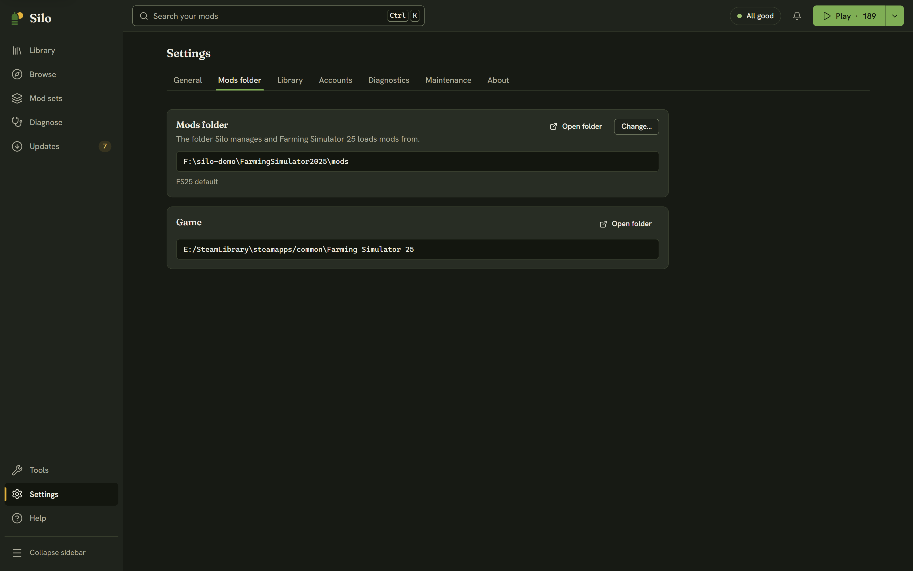

By default FS25 reads `Documents\My Games\FarmingSimulator2025\mods`, but the game can be set to read another folder (the mods directory override in its `gameSettings.xml`). Silo follows that setting on its own. When it starts using a custom folder the game is set to, it tells you once: "Silo now uses the mods folder FS25 is set to". You can also choose any folder yourself, for example one on a bigger drive.

## Where to find it

Open **Settings**, then **Mods folder**. The **Mods folder** card shows the folder Silo uses and where that choice came from: **FS25 default**, **Following FS25's setting** or **Chosen in Silo**, with "not available" added when the folder can't be reached. **Open folder** shows it in your file manager.

The **Game** card below it shows where Farming Simulator 25 is installed. If Silo can't find the game, the Play button is hidden.

## Changing the folder

1. Click **Change…** and pick a folder. If it holds no mods yet, Silo asks first, and **Use this folder** goes ahead. Nothing is moved.
2. Silo switches to the folder and reads it. If the game still reads a different folder, Silo asks **Point Farming Simulator at this folder too?**
   - **Update FS25's setting** writes the new folder into FS25's `gameSettings.xml` and keeps a backup of it (`gameSettings.xml.bak`), so you can switch back later. Close FS25 first: the game rewrites that file when it exits.
   - **Only in Silo** leaves the game alone. Use it when you only want to look at or tidy another folder.

Once you've chosen a folder in Silo, **Use the game's folder** on the same card goes back to the one FS25 reads.

Changing folders waits for a few things first: a scan or another change has to finish, a library archive move has to finish or be cancelled, and an unfinished [Find the problem mod](/help/guided-bisection/) has to be finished or cancelled, because it belongs to the folder it started in.

## When the game reads a different folder

If Silo and the game end up on different folders, a notice says "FS25 is reading a different mods folder. Mods you activate here won't load in-game." Choose one:

- **Point FS25 here** updates the game's setting to Silo's folder, with the same backup.
- **Switch Silo to the game's folder** goes back to the folder FS25 reads.

## Several folders, each with its own library

Silo remembers each folder's library separately. Switching away and back brings that folder's library back exactly as you left it. Folders you've used before are listed under **Other folders Silo knows**, with how many mods each holds. Click **Switch** next to one to use it.

## If the folder goes missing

If a folder you chose can't be found (an unplugged drive, a renamed folder), Silo reads nothing and shows "Your mods folder isn't available", with **Try again**, **Choose another** and **Use the game's folder**. If FS25 simply hasn't created its `mods` folder yet, you'll see **Create it** and **Choose a folder** instead.

If a folder overlaps one Silo already manages in another way, Silo won't change files in it and its notice says why, with **Choose another**.

## Cloud-synced folders

If your mods folder is synced by a cloud service (OneDrive, Google Drive or Proton Drive), Silo copies active mods instead of linking them. It works, but uses more disk. Excluding `…\My Games\FarmingSimulator2025` from your cloud sync lets Silo link them again. See [Your library](/help/library/).

> On **Linux**, FS25 runs through Steam Proton and stores its setting as a Windows-style path. Silo translates it to the real folder through the Proton prefix. If it can't, the **Mods folder** card says so: choose the folder with **Change…**.
