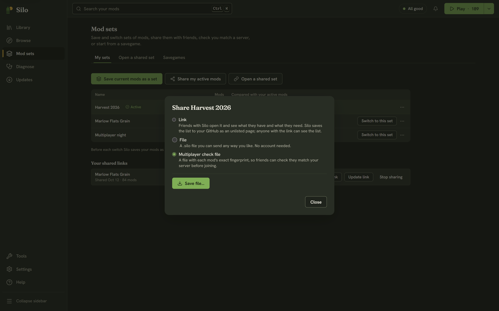

Everyone in a Farming Simulator 25 session needs the same mods, at the same versions, with the same files. A mismatch is a common reason a join fails, and finding the one mod that differs can take a while. Silo turns it into a checklist: the host shares a **Multiplayer check file**, and each player checks their active mods against it.

Making or checking the file never changes your mods. Only the buttons in the fix list do, and each one says what it does.

## Host: share the check file

1. Open **Mod sets**, then **My sets**.
2. Click **Share my active mods**, or choose **Share…** from the **⋯** menu of the set your server runs.
3. Choose **Multiplayer check file** and click **Save file…**. The file name ends in `.silomp`.

Silo fingerprints each mod file and says how many it saved. Send the file to your players any way you like: Discord, email or a shared folder. Save a new one whenever the server's mods change.

## Player: check your mods

1. Open **Mod sets**, then **Open a shared set**.
2. Click **Choose a file…** and pick the host's `.silomp` file.
3. Click **Check my mods**.

Silo compares the file with your active mods: names, versions and each file's fingerprint. Then it says either "You match. You're ready to join." or that your mods don't match yet, with a fix list:

- **The server has these and your active mods don't**: **Turn on** for a mod you have parked, or **Find in Browse** for one you don't have.
- **Different version or file than the server**: shows your version and the server's, or "a different file" when the versions agree but the files don't. Get the server's build; **Find in Browse** is a place to start.
- **Active for you but not on the server**: **Park** it while you play on this server. Parking never deletes it.

Work through the list, then click **Check again**.

Once you match, it's worth saving your active mods as a set, so you can switch back to the server's mods next time in one step. See [Mod sets](/help/loadouts/).

## What the check can and can't tell

The comparison is byte for byte. A mod repacked with the same contents still reads as a different file, so Silo errs toward "get the server's copy", which is the safe direction for multiplayer.

Mods in unpacked folders can't be fingerprinted. When the host's mods include any, the Share dialog says so, and players see them as not matching. For a clean check, use packed `.zip` mods on both sides.

Only active mods are compared, so a player's parked mods never count against them.

Both sides need Silo. The host's file holds names, versions and fingerprints, never the mods themselves.
