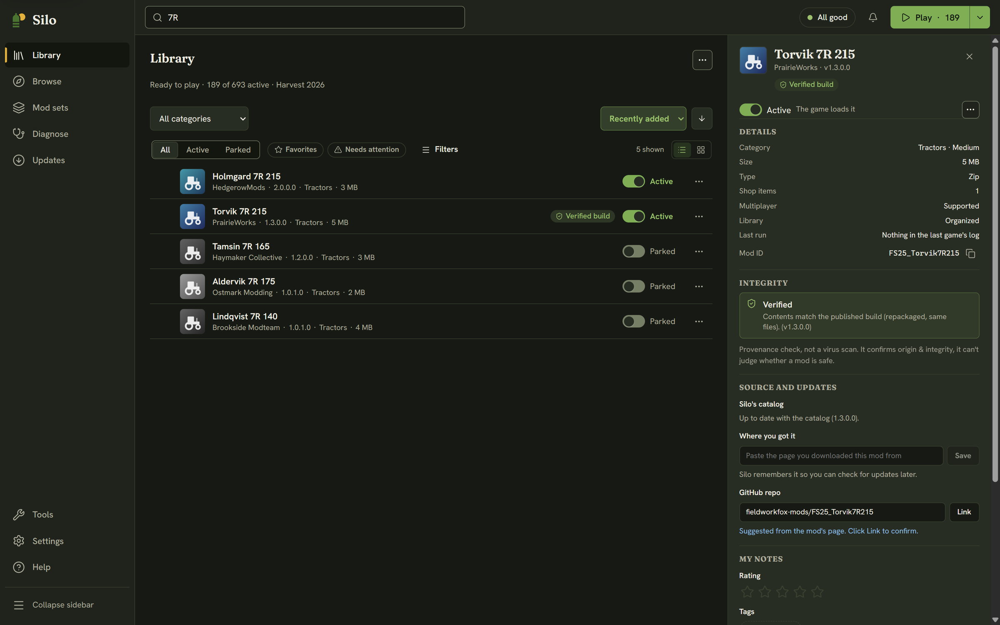
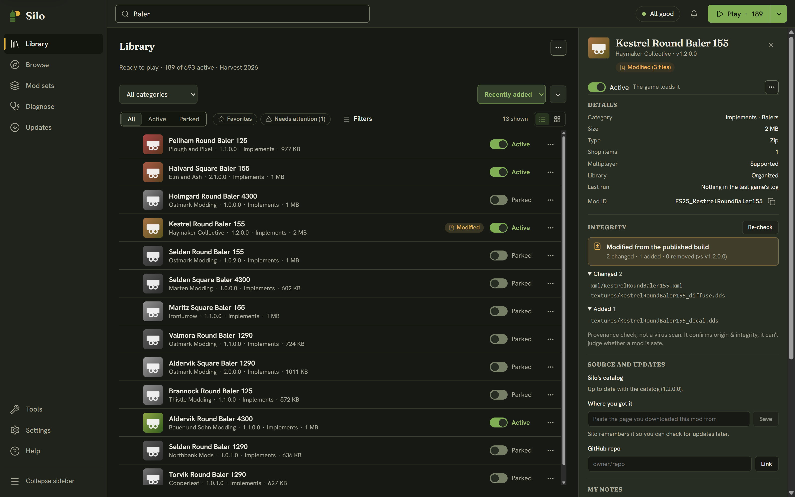

The integrity check answers one question: **is this the build its author published, or has something in it changed since?** Silo hashes the mod file on your computer and compares it with the published build that Silo's catalog hashed from the mod's own source. It's worth running when a mod came from somewhere other than its official page, when an update behaves oddly, or when you simply want to know that what's on disk is what shipped.

This is a provenance check, not a virus scan. A **Verified** result confirms where the files came from and that they're intact. It can't judge whether a mod is safe, and it doesn't guess at anyone's intent. The check only reads and hashes the file. It never moves or changes anything, so there is nothing to undo.

## Running the check

Open a mod's details (click its row in the **Library**) and scroll to the **Integrity** section. Click **Verify integrity**. Silo shows *Hashing & comparing…* while it works, then one of three results. Only zipped mods can be checked: for a folder mod (an unzipped one) the section explains there's no archive to hash.

To fetch the published build's file list, Silo sends the catalog only the mod's Mod ID and version. The hashing and the comparison happen on your computer.

## The three results

- **Verified**: your copy matches the published build. Either it's a byte-for-byte match, or the contents match (the zip was repacked, but every file inside is the same). The matched version is shown, and the details header carries a green **Verified build** badge.
- **Modified from the published build**: it's the same mod, but some files differ. You see how many were changed, added and removed, with lists you can expand that name each file. The header badge reads **Modified** with the number of files, for example **Modified (3 files)**. This tells you exactly what differs. On its own it doesn't mean the change is harmful: a mod you edited yourself shows up this way too.
- **Unverified**: Silo has no hashed build on file for this mod or this version, so it can't say either way. The note says which: the mod isn't in the catalog yet, or there's no hashed build for this exact version. An Unverified result is never a mark against a mod, and it gets no badge.

After a Modified or Unverified result, **Re-check** runs the check again.

## Where the result shows

Silo remembers each result until you close it, as long as the file doesn't change. The **Verified build** or **Modified** badge also appears on the mod's row in the Library, and a Modified mod is included when you turn on the **Needs attention** filter.

## What can be checked

Silo can check GitHub builds, which the catalog keeps hashing as new releases come out. It can also check ModHub builds that the catalog hashed before it paused downloads from GIANTS' servers. A ModHub version released since then usually shows **Unverified**, while update checks for ModHub mods carry on as usual. In **Browse**, a **Verified build** badge on a card means the catalog has that published build hashed, so Silo can check your copy once you have it. The [trust page](/trust/) explains how the catalog works.
