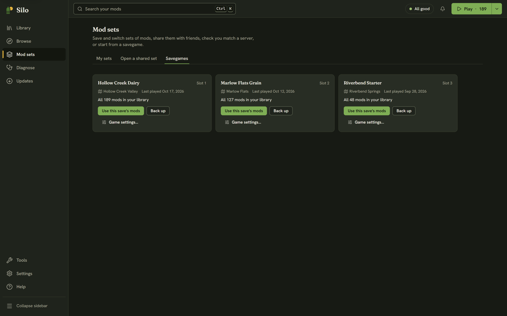

**Mod sets**, then **Savegames** shows one card per career save in your Farming Simulator 25 user folder: its name and slot, the map, when it was last played, and how many of its mods are in your library, such as "41 of 44 mods in your library. 3 missing". DLC doesn't count, only mods you install.

## Using a save's mods

**Use this save's mods** switches your active mods to the mods that save used. Silo first shows the same preview as switching to a mod set: how many mods turn on, how many are parked, and the list of changes. Mods the save used that aren't in your library are left out. Click **Switch** to go ahead.

Silo saves those mods as a set named after the save, so you can switch back to them from **My sets** later. It also saves the mods you had on as an automatic "Before" set, and a toast offers **Undo**. See [Mod sets](/help/loadouts/).

The button is off until Silo has read your library, and when none of the save's mods are in it.

## Missing mods

When a save uses mods you don't have, **Show missing mods** lists them, each with **Find in Browse**. The **Play** menu (the arrow beside **Play**) also names saves that use mods you don't have, and choosing one opens this tab.

## Backing up a save

**Back up** copies the whole savegame folder into a `SiloBackups` folder in your Farming Simulator 25 user folder, named after the save's folder and the time of the backup. The save itself isn't changed. To restore one, close the game, then put the backup folder back in place of the save's folder under its original name (for example `savegame1`).

**Back up** waits while another change to your library is running, and says why.

## Game settings

**Game settings…** opens the save's `careerSavegame.xml` as a short form, without launching the game. It covers Save name, Economic difficulty, Growth, Fuel usage, Dirt interval, Time scale and Autosave interval, plus switches for Crop destruction, Plowing required, Stones, Weeds, Lime required, Snow, Traffic, and whether helpers buy fuel, seeds and fertilizer. The **Casual** and **Realistic** presets fill several fields at once, and you can still change any of them afterwards.

**Save changes** stays off until you change something, and writes only the values you changed. **Close** or Esc leaves without saving. Silo won't save while Farming Simulator 25 is running, because the game saves its own settings when it exits and the change would be lost.

Before every save, Silo backs up the file beside it. It keeps the original as `careerSavegame.xml.silo-original.bak`, which is never replaced, and the three versions before your latest edit as `.bak`, `.bak.2` and `.bak.3`. If the backup can't be made, nothing is written. To go back, close the game and copy the backup you want over `careerSavegame.xml`. For a full copy of the career before you experiment, use **Back up** first.

## Graphics settings

For the game's graphics, open **Tools**, then **Graphics settings**, and click **Edit game.xml**. It works the same way, with fields such as Performance class, Shadow map size and FSR upscaling, and **Performance**, **Balanced** and **Quality** presets. Changes take effect the next time you launch the game.
