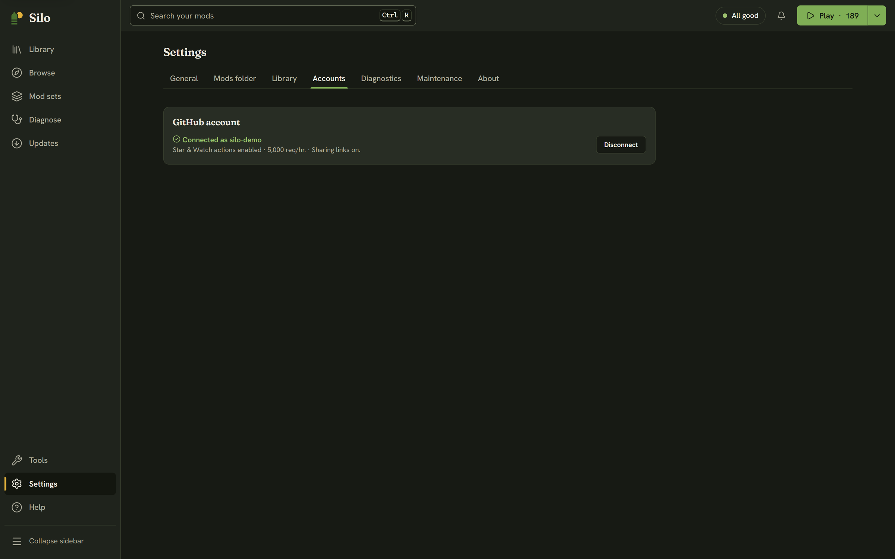

Open **Settings** from the bottom of the sidebar, or press Ctrl+,. The page has seven sections: **General**, **Mods folder**, **Library**, **Accounts**, **Diagnostics**, **Maintenance** and **About**. Nothing here changes your mod files until you press a specific button, and the ones that move files ask first.

## General

- **Theme:** **System**, **Light** or **Dark**. System follows your computer's light or dark setting.
- **UI size:** 90%, 100%, 110% or 125%. It makes text and icons smaller or larger everywhere in Silo.
- **List density:** **Comfortable** or **Compact**. Compact fits more mods on screen in the Library list.
- **Check for mod updates when Silo starts:** off unless you turn it on. Checking sends the names of your installed mods to Silo's catalog. Versions are compared on your computer. Silo only checks: you choose what to install in [Updates](/help/updates/).
- **Graphics settings:** **Edit game.xml** tunes Farming Simulator 25's graphics without starting the game. It's also in **Tools**, then **Graphics settings**.

## Mods folder

The folder Silo manages and the game loads mods from, where that choice came from, **Change…**, other folders Silo knows, and where the game is installed. See [Choosing your mods folder](/help/mods-folder/).

## Library

- **Library layout:** **Organize** files loose mods into category folders. See [Organizing and curating](/help/curation/).
- **Auto-file new mods:** files new zips as they appear, without asking. Off unless you turn it on.
- **Library archive:** where Silo keeps parked mods, with **Change…** to move it and **Use default** to bring it back. See [Moving your library archive](/help/library-archive/).

## Accounts

A GitHub account is optional. Click **Connect GitHub**: a browser opens to `github.com/login/device`, and you enter the code Silo shows. Silo keeps working while it waits, and **Cancel sign-in** stops it. Connecting asks GitHub only for `read:user` (your user name), which gives faster update checks (5,000 requests per hour).

Two more permissions are separate, optional steps once you're connected:

- **Enable actions** adds `public_repo`, so **Star** and **Watch** on a mod's GitHub page land on your account.
- **Enable sharing links** adds `gist`, so you can [share a mod set](/help/collections/) as an unlisted link on your GitHub.

**Disconnect** removes the connection at any time. **Use a Personal Access Token instead…** is there if you'd rather give Silo a token you made yourself. The token is kept in your computer's keychain. If there isn't one, Silo warns you before you connect that the token would be stored unencrypted in its own database.

## Diagnostics

A summary of your library, conflicts and health issues, plus Silo's recent log, with your user name removed:

- **Copy diagnostics** puts it on the clipboard for a bug report. If the clipboard isn't available, Silo saves it to a file instead.
- **Export report** saves it as `silo-report.md`.
- **Open log folder** shows Silo's own log files.

## Maintenance

- **Re-read every mod** scans every mod again from scratch. Use it after a Silo update improves categories, so existing mods pick them up.
- **Reclaim disk space** turns any active mod that ended up as a full copy back into a link, freeing the duplicated space. It only touches files identical to the copy in your library, never a build you swapped in. On a cloud-synced folder it explains why copies are used instead.
- **Undo organizing** puts every mod back in your mods folder and removes Silo's links. Nothing is deleted. It's the only undo for organizing.

## About

Your Silo version and the last library scan, plus links to the website, the source code, the changelog, Discord and GitHub Discussions. When a new Silo is ready, a notice says so, and **Restart to update** here (or on the notice) installs it and restarts Silo. Silo's license and the third-party licenses are in **Help**, under **About Silo**.
