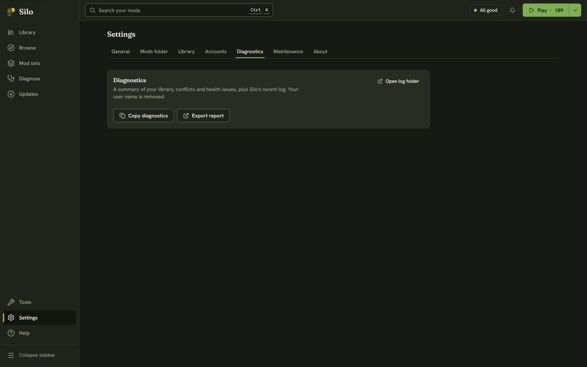

When something goes wrong, Silo says what happened and what to do, and every error has **Copy details** for a bug report. Recent errors are also listed under the **Activity** bell in the header.

## Common messages

- **"Silo couldn't move … because another program is using it."** Close Farming Simulator 25 or the program that has the file open, then **Try again**.
- **"Close Farming Simulator 25 first, then try again."** Silo doesn't change mod files while the game is using them.
- **"Silo is finishing another change to your library. Try again in a moment."** One change runs at a time. The **Activity** bell shows what's running.
- **"Finish or cancel the library move first."** A library archive move is running or paused. Resume or cancel it from the notice at the top. See [Moving your library archive](/help/library-archive/).
- **"Your library archive isn't available. Connect the drive, or choose another folder."** The drive holding your parked mods isn't connected. Nothing is deleted.
- **"Windows didn't let Silo change this file."** The file is in a protected folder. Choose a mods folder in your Documents.
- **"There isn't enough space on the drive for this."** Free some space, then try again.
- **"Silo can't reach the internet right now."** or **"The download stopped responding."** Browse and Updates need the internet. Your library still works.
- **"GitHub is limiting requests for a while."** Connecting your GitHub account in **Settings**, then **Accounts** raises the limit.
- **"GitHub needs you to sign in again."** Reconnect in **Settings**, then **Accounts**.
- **"That file isn't a Farming Simulator mod."** The file isn't a mod the game can load.
- **"This library was used by a newer Silo."** Install the latest Silo to open it.

For crashes and mods that won't load, start with [Last run](/help/crash-triage/) and [Problems](/help/health/) in Diagnose.

## Windows SmartScreen or macOS warns on first launch

Silo's Windows installers are signed by Silo's developer, **David Hellmer**, so the prompt names that publisher instead of "unknown". SmartScreen builds reputation per release, so a brand-new build may still prompt: click **More info**, then **Run anyway**. The macOS and Linux builds aren't signed with an OS certificate, so macOS blocks the first launch: open Silo once, then go to **System Settings**, then **Privacy & Security**, and click **Open Anyway**. You can [verify the signature, checksum and build provenance](https://github.com/HLLMR/silo/blob/main/docs/VERIFY_DOWNLOAD.md) yourself.

## Do I need Developer Mode or administrator rights?

Almost never. Packed `.zip` mods are linked into your mods folder on the same drive with no admin rights and no Developer Mode. The one exception is a [library archive on another drive](/help/library-archive/): links across drives need Developer Mode on Windows, so without it Silo copies active mods instead. That works, it just uses more disk.

## Is my library safe? Can I undo this?

Yes. Parking never deletes a mod, and switching mods on or off shows **Undo** right away. Organizing shows every move before anything happens, and **Settings**, then **Maintenance**, then **Undo organizing** puts every mod back into your mods folder. Mod updates keep the previous version in backups. Silo never deletes a file it doesn't recognize, never removes the only copy of a mod, and leaves alone a build you swapped into the mods folder yourself.

## Where does Silo keep its data?

Your mods stay in your mods folder or your library archive. Silo's own database (`silo.db`: the library index and your notes, tags and ratings) lives in the app's data folder for your user. A GitHub token goes into your computer's credential store (Windows Credential Manager, macOS Keychain, Linux Secret Service). On Linux without a keyring, Silo keeps it in its own database and warns you first.

## Why does a mod show no Verified build badge?

Silo can only verify a build it has a published copy of to compare against. No badge isn't a warning about the mod. See [how Silo checks a build](/help/provenance/). This is a provenance check, not a virus scan.

## Where to ask

1. Copy your diagnostics: **Settings**, then **Diagnostics**, then **Copy diagnostics**. It's a summary of your library and Silo's recent log, with your user name removed.
2. Ask on the [Silo Discord](/discord) or in [GitHub Discussions](https://github.com/HLLMR/silo/discussions). Include your Silo version (**Settings**, then **About**), the diagnostics, and for a crash the game's `log.txt`.
3. For a bug, **Help**, then **Report a problem** copies the diagnostics and opens the bug report form on GitHub, ready to paste.

