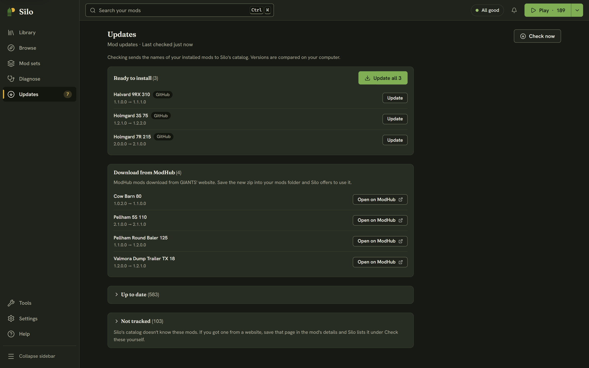

**Updates** (Alt+5 in the left rail) is the one place to check for mod updates and install them. It compares your mods with Silo's catalog, which knows the latest version of each mod across ModHub and GitHub, so a mod from one source doesn't look out of date just because the other has a different version.

## Checking

Silo checks only when you click **Check now**. The page says what that involves:

> Checking sends the names of your installed mods to Silo's catalog. Versions are compared on your computer.

Mods you've linked to a GitHub repository are also checked with GitHub directly, and that answer wins for them. The header shows when you last checked.

The first time you open **Updates**, Silo asks whether to check when it starts: **Check on start** or **Only when I ask**. It stays off unless you turn it on, and you can change it any time in **Settings**, then **General**, with **Check for mod updates when Silo starts**.

## What a check finds

Results are grouped, and empty groups are hidden:

- **Ready to install**: newer GitHub releases. **Update** installs one, and **Update all** installs them one after another.
- **Download from ModHub**: newer versions on ModHub, with **Open on ModHub**. See below.
- **Check these yourself**: mods with a saved download page, oldest-checked first, with **Open page** and **I checked it**.
- **Couldn't check**: each with the reason, **Try again** and **Copy details**.
- **Up to date** and **Not tracked**, collapsed. Not tracked means Silo's catalog doesn't know the mod.

After a check, **Updates** in the rail shows how many are waiting, and those mods carry an **Update** badge in the **Library**. **Needs update** in the Library's **Filters** popover lists just them.

## Installing an update

Silo downloads the new version beside the old one, checks that it's a complete archive of the same mod, then swaps it in. The previous version goes to the `backups` folder in your mods folder, which keeps the newest three per mod, and an active mod stays active. A toast confirms it, for example "Updated Courseplay to 8.0.1.0. The previous version is in backups."

**Update all** shows its progress in the header and ends with one summary, such as "3 updated, 1 failed". A failed row says why, with **Try again**.

Silo won't update while Farming Simulator 25 is running: close the game first. If Silo stops partway through an update, it finishes or rolls back the swap the next time it reads your library, and tells you what it did.

## ModHub updates

ModHub mods download from GIANTS' website, so Silo can't install them for you. Instead:

1. Click **Open on ModHub** and download the new `.zip` from the mod's page.
2. Save it into your mods folder, replacing the file with the same name.
3. Come back to Silo. It finds the newer build and shows "Found a newer" with the mod's name and **Use this version**. The row in **Updates** offers the same button.

**Use this version** makes the new file the one Silo keeps, and moves the old build to `backups`. The mod's details show the same choice in a banner, with **Keep Silo's** if you change your mind. See [Problems in your library](/help/health/).

## Mods from other websites

For a mod that isn't on ModHub or GitHub, open its details and, under **Source and updates**, paste the page you got it from into **Where you got it**, then click **Save**. Later checks list it under **Check these yourself**. Silo only stores the address; your browser visits the page when you click **Open page**. If the page is a GitHub repository, Silo also links the mod to it, so it's checked with GitHub from then on.
